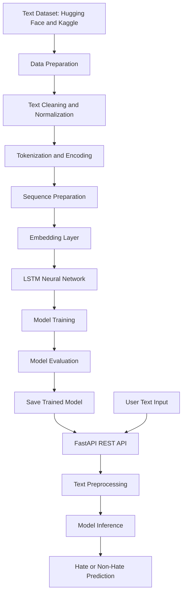

# 🛡️ Hate Speech Detection Using NLP & Deep Learning

An end-to-end Natural Language Processing (NLP) and Deep Learning project that classifies text as **Hate** or **Non-Hate** using an LSTM-based neural network. The project covers text preprocessing, embedding-based representations, model training, evaluation, and real-time inference through a FastAPI REST API deployed on Render.

🔗 **Live Demo:** [Try the Application](https://hate-speech-classification-project-nlp-24qa.onrender.com/)

📂 **GitHub Repository:** [Hate Speech Classification — NLP](https://github.com/TusharK93/Hate-Speech-Classification-Project---NLP-Natural-Language-Processing-)

---

## 📌 Project Overview

The rapid growth of social media and online communities has made content moderation increasingly challenging. Manually reviewing large volumes of comments and posts is time-consuming and difficult to scale.

The **Hate Speech Detection** project uses Natural Language Processing and a Long Short-Term Memory (LSTM) neural network to classify textual content into hate and non-hate categories.

The model is trained using datasets sourced from Hugging Face and Kaggle. The project demonstrates an end-to-end Deep Learning workflow, from text preprocessing and embedding generation to model evaluation and cloud deployment.

## 🎯 Problem Statement

Online platforms receive large volumes of user-generated content every day. Harmful language can negatively affect individuals and communities, while manual moderation requires substantial time and resources.

Key challenges include:

- Time-consuming manual comment moderation.
- Difficulty scaling moderation across large volumes of text.
- Understanding contextual and sequential patterns in language.
- Handling variations in spelling, vocabulary, and sentence structure.
- Maintaining consistent content classification.

**Objective:** Develop an automated text classification system that identifies potentially hateful content and supports faster, scalable content moderation.

## 💡 Solution

Built an LSTM-based text classification model that processes textual input and predicts whether the content belongs to the Hate or Non-Hate category.

The solution incorporates multiple NLP and Deep Learning techniques to improve text representation, training, and generalization.

### Key techniques

- Text cleaning and normalization.
- Tokenization and sequence preparation.
- Vocabulary processing and text encoding.
- Embedding-based text representation.
- LSTM-based sequential learning.
- Training and test data separation.
- Model evaluation using classification metrics.
- A reusable prediction pipeline.
- FastAPI-based REST API development.
- Cloud deployment on Render.

## ⚙️ Key Features

- **Automated Hate Speech Classification:** Predicts Hate or Non-Hate labels for submitted text.
- **LSTM-Based Architecture:** Learns sequential patterns in text.
- **Text Preprocessing:** Converts raw text into a model-compatible representation.
- **Embedding-Based Learning:** Represents text as numerical vectors for neural network processing.
- **Deep Learning Pipeline:** Organizes model training, evaluation, and inference.
- **Real-Time Prediction API:** Exposes model predictions through FastAPI.
- **Modular Architecture:** Separates text processing, model inference, and API functionality.
- **Error Handling:** Supports more robust handling of invalid inputs and inference failures.
- **Cloud Deployment:** Makes the prediction service accessible through Render.

## 🏗️ Project Architecture

The following diagram illustrates the high-level workflow.



*This diagram represents the conceptual workflow. The exact preprocessing stages, model layers, and output format depend on the repository implementation.*

## 🛠️ Technology Stack

| Category | Technologies |
|---|---|
| Programming Language | Python |
| Natural Language Processing | NLP, text preprocessing, tokenization |
| Deep Learning | LSTM, neural networks |
| Text Representation | Embeddings |
| Data Sources | Hugging Face, Kaggle |
| Model Evaluation | Accuracy, precision, recall, F1 score |
| API Development | FastAPI |
| Deployment | Render |
| Version Control | Git, GitHub |

## 🧠 Model Approach: LSTM

Long Short-Term Memory (LSTM) is a type of recurrent neural network designed to learn sequential relationships in data.

For text classification, the model processes a sequence of token representations and learns patterns that help distinguish between the target categories.

### High-level model pipeline

1. Convert input text into tokens.
2. Transform tokens into numerical sequences.
3. Apply padding or truncation to obtain compatible sequence lengths, if required.
4. Generate dense representations through an embedding layer.
5. Process the sequences using an LSTM network.
6. Pass learned features through the classification layers.
7. Generate a prediction for the Hate or Non-Hate category.

The trained model and its preprocessing configuration must remain consistent between training and inference to ensure reliable predictions.

## 📊 Results & Business Impact

The project achieved the following reported results on the test set:

<box border radius="xl" padding={4} gap={3}>
  <grid columns={2} gap={4}>
    <grid-item>
      <text color="secondary" size="sm">Test Accuracy</text>
      <title size="2xl" color="success">95%</title>
    </grid-item>
    <grid-item>
      <text color="secondary" size="sm">Test F1 Score</text>
      <title size="2xl" color="success">93%</title>
    </grid-item>
  </grid>
</box>

### Business impact

- **95% accuracy:** Indicates strong reported classification performance on the test dataset.
- **93% F1 score:** Reflects the balance between precision and recall.
- **Reduced manual effort:** Helps prioritize content for moderation.
- **Scalable inference:** Provides an API-based interface for processing text.
- **Faster screening:** Supports automated preliminary review of user-generated content.

*These are reported project metrics. Actual performance depends on dataset composition, class balance, the evaluation methodology, and the distribution of real-world content.*

## 📈 Model Evaluation

The model can be assessed using the following metrics:

- **Accuracy:** Proportion of correctly classified text samples.
- **Precision:** Proportion of predicted hate speech samples that are actually labeled as hate speech.
- **Recall:** Proportion of actual hate speech samples identified by the model.
- **F1 Score:** Harmonic mean of precision and recall.
- **Confusion Matrix:** Shows the distribution of correct and incorrect predictions across classes.

For content moderation, precision and recall are particularly important. Low precision can result in legitimate speech being incorrectly flagged, while low recall can allow harmful content to go undetected.

## 🚀 Live Deployment

The application is deployed on Render using a FastAPI REST API for text-based inference.

- **Live Application:** [Hate Speech Detection](https://hate-speech-classification-project-nlp-24qa.onrender.com/)
- **Source Code:** [GitHub Repository](https://github.com/TusharK93/Hate-Speech-Classification-Project---NLP-Natural-Language-Processing-)

The service accepts text input and returns a classification based on the trained model and the API's implemented response format.

## ⚙️ Getting Started

Follow these steps to run the project locally.

### Prerequisites

- Python version compatible with the repository.
- Git.
- Required Python dependencies.
- Trained model weights and tokenizer or vocabulary artifacts, if not included in the repository.

### Step 1: Clone the repository

```bash
git clone https://github.com/TusharK93/Hate-Speech-Classification-Project---NLP-Natural-Language-Processing-.git

cd Hate-Speech-Classification-Project---NLP-Natural-Language-Processing-
```

### Step 2: Create a virtual environment

```bash
python -m venv .venv
```

Activate the environment.

**Windows**

```bash
.venv\Scripts\activate
```

**macOS / Linux**

```bash
source .venv/bin/activate
```

### Step 3: Install dependencies

If the repository contains a `requirements.txt` file:

```bash
pip install -r requirements.txt
```

### Step 4: Run the API

For a FastAPI application, a common command is:

```bash
uvicorn app:app --reload
```

Replace `app:app` with the correct module and application instance name if your entry point differs.

### Step 5: Open the API documentation

If Swagger documentation is enabled, open:

```text
http://127.0.0.1:8000/docs
```

Use the interactive API documentation to inspect the available endpoints and submit text for classification.

## 🔒 Responsible AI Considerations

Automated hate speech detection is a challenging NLP task because language can be ambiguous, context-dependent, and culturally specific.

Important considerations include:

- **Context sensitivity:** Quoted speech, satire, and discussion of hateful language may be misclassified.
- **False positives:** Legitimate criticism, reclaimed language, or identity-related discussions may be incorrectly flagged.
- **False negatives:** Harmful content may not always be recognized by the model.
- **Dataset bias:** Training data may not represent every language, community, or communication style.
- **Human review:** High-impact moderation decisions should include appropriate human oversight.

The model should be treated as a moderation-support tool rather than an infallible decision-maker.

## 🔮 Future Enhancements

Potential improvements include:

- Transformer-based models such as BERT for contextual text representations.
- Multilingual hate speech detection.
- Explainability tools to highlight influential words or phrases.
- Confidence calibration and configurable decision thresholds.
- Class-specific performance monitoring.
- Robustness testing against misspellings and adversarial text.
- Human-in-the-loop moderation workflows.
- Model monitoring and periodic retraining.
- Improved handling of class imbalance and dataset bias.

## 🎓 Skills Demonstrated

- Natural Language Processing.
- Text preprocessing and tokenization.
- Word embeddings and sequence modeling.
- LSTM-based Deep Learning.
- Text classification.
- Model training and evaluation.
- Precision, recall, accuracy, and F1 score analysis.
- FastAPI and REST API development.
- Model serialization and inference.
- Git, GitHub, and cloud deployment.
- Responsible AI and content moderation considerations.

## 💼 Why This Project Matters

Automated content moderation is an important application of NLP and Deep Learning for social media platforms, online communities, forums, and digital services.

This project demonstrates how a sequential neural network can be integrated into a practical text classification pipeline and deployed through a REST API.

It showcases relevant skills for **Machine Learning Engineer, NLP Engineer, Deep Learning Engineer, Data Scientist, and AI Engineer** roles.

## 👨‍💻 Author

**Tushar K**

- GitHub: [@TusharK93](https://github.com/TusharK93)

## 📄 License

Add a `LICENSE` file to the repository if you intend to distribute the project under an open-source license.

---

⭐ If you find this project interesting, consider starring the repository!

**Built with Python, NLP, LSTM, embeddings, and FastAPI to support scalable text classification and content moderation.**

<p align="center">
  
</p>
